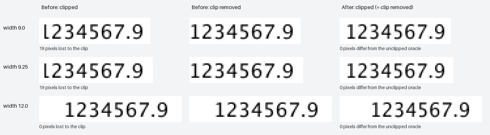

# GH-505 raster evidence



These are synthetic raw numeric cells containing `1234567.9`, rendered at 96 DPI with Apache
Batik 1.19 on macOS. The regression compares images generated by the running backend rather
than requiring a particular installed font or PNG golden. The number is in B1, with empty A1 and C1 providing room for the unclipped oracle.
The comparison image enlarges crops by 4× using nearest-neighbour sampling. Pixel counts compare
**every pixel of the original full-sheet images**, rather than the enlarged crops.

The before render is from `a19dbb6f` with the new `TightTextRasterSpec` fixture and no production
changes. Both width 9.0 (77px clip, 76px AWT advance) and width 9.25 (79px clip) lose 19 pixels at
the leading `1`. On this base, unlike the older observation in the issue, 9.25 also clips: both
widths clamp to the same anchor. Width 12.0 is the unclipped wide-column control. The raw numeric
cell draws at 15px; inserting a Scala `Double` attaches a style and draws at 14px, so that styled
control passes before and after. The fixture deliberately checks both paths.

After declaring `textLength="76" lengthAdjust="spacingAndGlyphs"`, Batik's clipped and unclipped
renders are identical at all three widths, including both ends of the number. The declaration
keeps the advance used by the anchor calculation and the backend layout the same. It can scale
glyphs horizontally, also in wider columns; it does not add a safety margin or change the fit/hash
policy. See [SVG's text length contract](https://www.w3.org/TR/SVG11/text.html#TextElementTextLengthAttribute).

The [pixel comparison records](pixel-comparison.json) and the width-9.0
[before SVG](before-width-9.0.svg) / [after SVG](after-width-9.0.svg) accompany the image.
An independent render through the already bundled sharp/librsvg 2.63.2 found zero clipped pixels
before and after at widths 9.0, 9.25 and 12.0. No font, image asset or library dependency was added
to the project.

To regenerate the current Batik raster evidence, run:

```sh
XL_505_EVIDENCE_DIR=/tmp/xl-505 ./mill -i xl-cli.test.testOnly com.tjclp.xl.cli.raster.TightTextRasterSpec
```

Without the environment variable, the suite cleans up its temporary SVGs and PNGs. All builds, test suites and
resource-heavy validation for this change ran through the batch's shared `run-check.py` lock.
